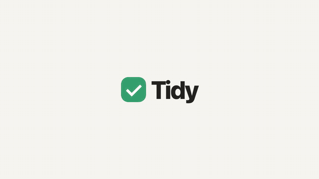

# Product Video Kit

**Make polished product videos from code** — app walkthroughs, launch films, explainers — with free,
local tools. No video editor, no paid services, no stock-footage subscriptions.

[](https://github.com/Arnavxy/product-video-kit/actions/workflows/ci.yml)
[](LICENSE)

<p align="center"></p>

You write a script, a scripted screen recording and a small HTML "edit". The kit voices the script with
neural TTS, records your product with Playwright, cuts every shot to the spoken words and the music's
beat, renders 1080p60 frames in headless Chrome, designs the sound, mixes, and encodes an mp4.
Because the whole edit is code, changing a line of the script or re-recording a screen re-flows the
film with one command.

```bash
git clone https://github.com/Arnavxy/product-video-kit && cd product-video-kit
./setup.sh          # once: ffmpeg, Node, Python libs, headless Chromium (macOS or Debian/Ubuntu)
./video.sh all      # builds the example → projects/example/out/tidy-example.mp4 (~1 min)
```

---

## The tools

| Job | Tool | Why this one |
|---|---|---|
| Record the product | **Playwright** + Chrome DevTools screencast (`record.mjs`) | Scripted, repeatable take at 2× (Retina). Logs every tap and named moment so the edit can sync to them. Re-record any time the UI changes. |
| Capture a website | **Playwright** (`tools/capture_site.mjs`) | Scrolls first so scroll-animations fire, then saves each section, the full page and every image. |
| Use Figma designs | **Figma REST API** (`tools/figma_export.py`) | Exports every screen frame in a section as PNG — make a film from designs before the app exists. |
| Edit / animate | **HTML + CSS + JS "director"** (`film/film.js` + `tools/engine.js`) | The edit is code: `render(t)` draws the frame at time *t*. Phone mock-ups, zooms, captions, subtitles, title cards — anything a browser can draw. |
| Render | **Playwright** (headless Chrome) → JPEG frames (`tools/render.mjs`) | Deterministic, 1080p60, parallel pages. |
| Voiceover | **edge-tts** — Microsoft neural voices, free, no account (`tools/vo.py`) | Natural voices (Andrew, Ava, Hindi Swara…) **with word timings**, so visuals land on exact words. |
| Music | Any track (e.g. **Mixkit**, free licence) + beat-grid fit (`tools/beatgrid.py`), or the built-in synth bed (`tools/music.py`) | Cuts land on the beat. The fit measures the real tempo from the drums — never trust a listed BPM. |
| Sound effects | Synthesised in **numpy** (`tools/mix.py`) | Whooshes, taps, pops, impacts, chimes — generated, no sample licences. Placed by `cue()` calls in the film. |
| Mix | **numpy + ffmpeg loudnorm** (`tools/mix.py`) | Music ducks under the voice automatically; output normalised to −14 LUFS (YouTube/Instagram level). |
| Encode | **ffmpeg** (H.264 + AAC) | Plays everywhere: WhatsApp, Slack, Drive, YouTube, Keynote. |
| QA | `tools/qa.py`, `tools/sheet.py` | Finds blank frames and jumpy cuts; contact sheet of stills to review the whole film at a glance. |

Optional: **Claude Code** in this folder does all of the above from plain English — see [CLAUDE.md](CLAUDE.md).

---

## Setup (once, ~5 minutes)

Requirements: macOS or Linux, Node 18+, Python 3.9+, ffmpeg. `./setup.sh` installs what's missing
(Homebrew on macOS — install it from https://brew.sh first; apt on Debian/Ubuntu), then checks each piece.
Re-run it any time. Windows: use WSL.

## Make the example film (~2 minutes)

```bash
./video.sh all
open projects/example/out/tidy-example.mp4
```

That runs every step on a tiny fake to-do app (`projects/example/demo-app/`): records it, voices the script,
builds the music, edits, renders, mixes and checks the result. Read `projects/example/film/film.js` alongside
the video — it's the clearest way to see how the edit works.

---

## Make your own film — step by step

```bash
./video.sh new my-film          # copies the example to projects/my-film
```

### 1. Write the script — `project.json`
Each line becomes one voiceover clip. `gap` = seconds of silence before the line (use 1–2 s before a new
section so the picture can breathe).
```json
{ "id": "add", "gap": 1.4, "text": "Add a task in one tap. Type it, and it's on your list." }
```
Voice settings: `voice` (list them with `edge-tts --list-voices`; good ones: `en-US-AndrewNeural`,
`en-US-AvaNeural`, `en-IN-NeerjaNeural`, `hi-IN-SwaraNeural`), `rate` (`"+6%"` faster, `"-5%"` slower), `pitch`.

```bash
./video.sh vo my-film      # listen to projects/my-film/vo/*.mp3; edit text and re-run — only changed lines regenerate
```

### 2. Record the product — `record.mjs`
Point `URL` at your app (local dev server, staging, or a live site) and write the take: `tap(locator, name)`,
`type(text)`, `mark(name)`, `wait(ms)`. Names are what the edit syncs to.
```bash
./video.sh record my-film  # → clips/flow/ (frames) + film/clip.js (timings)
```
- Use test accounts and fake data. **Never let the take really publish, pay or message anyone** — mock those
  calls (Playwright `page.route`) or use a demo build.
- Phone apps: the viewport is 390×797 (an iPhone screen without the status bar; the film draws one).
  Desktop: set `W, H` to e.g. 1440×900 and put the screen in a browser frame instead of `KIT.phone`.
- No app yet? Skip recording and use Figma screens (below) as images.

### 3. Music (optional)
Without a track you get the built-in synth bed (fine for drafts and internal films). For real music:
1. Download a track, e.g. from https://mixkit.co/free-stock-music/ (free licence, no attribution) → save as
   `projects/my-film/music/track.mp3`.
2. `./video.sh beatgrid my-film` → measures the tempo and prints every bar's start time with a loudness bar.
3. Set `"music": { "start": <a bar time> }` in `project.json` — pick a bar just before a drop, so the film
   opens on energy (or a quiet bar for a calm opening).

### 4. Edit — `film/film.js`
The edit is a list of things on screen, each with a time window. Times come from the voice and the take,
never typed by hand:
```js
W('add', 'tap')            // when the word "tap" is spoken in line "add"
V('add').start / .end      // when the line starts / ends
clip.filmAt(tapTime)       // when a recorded tap appears in the film
KIT.snap(t)                // nearest music beat
cue(t, 'whoosh')           // a sound effect: whoosh, whooshdown, pop, tap, impact, chime, riser
```
The recorded take is re-timed with **anchors** — `[clip time, film time]` pairs, e.g. "the Add button tap
lands on the word *list*". Between anchors it plays at a constant speed (the engine warns if any section
would play slower than 0.4× or faster than 2.5×).

Preview without rendering: open `projects/my-film/film/index.html#12.5` in Chrome (the frame at 12.5 s),
or `#play` for rough playback. Or render stills:
```bash
./video.sh sched my-film && ./video.sh stills my-film          # 12 evenly spaced stills + stills/sheet.jpg
./video.sh stills my-film 3.2,7.8,15                            # specific moments
```

### 5. Build
```bash
./video.sh all my-film     # everything, from recording to mp4
./video.sh audio my-film   # after script/voice/music changes
./video.sh film my-film    # after film.js changes (re-renders)
./video.sh clean my-film   # delete frames/stills (GBs) — keeps the mp4
```
The mp4 lands where `project.json` → `out` says. Render speed is roughly 30–60 frames/s; `PAGES=6
./video.sh frames my-film` uses more CPU for a faster render.

---

## Other sources

**A website** — `node tools/capture_site.mjs https://example.com projects/my-film/assets/site` saves each
section, `full.png` and all images. Put them in the film as `` layers (a slow scroll of `full.png` inside
a browser frame is a classic).

**Figma designs** — create a personal access token (Figma → Settings → Security → Personal access tokens,
read-only file content), then:
```bash
export FIGMA_TOKEN=figd_xxx
python3 tools/figma_export.py "https://www.figma.com/design/KEY/Name?node-id=12-345" projects/my-film/assets/screens
```
Link a section or page (right-click → Copy link to selection); every screen frame inside it is exported in
reading order. View access is enough.

---

## Folder layout

```
setup.sh, video.sh          one-time setup; every build step
tools/                      shared — you rarely edit these
  engine.js, kit.css        the director engine (timing helpers, phone, clip player, subtitles, SFX cues)
  render.mjs                stills / frames / encode
  vo.py, sched.py           voiceover + placing it on the timeline
  beatgrid.py, music.py     music tempo fit + music bed
  mix.py                    voice + ducked music + SFX → mix.wav
  qa.py, sheet.py           checks and contact sheets
  capture_site.mjs, figma_export.py, browser.mjs
projects/<name>/
  project.json              script, voice, music, output path
  record.mjs                the screen take
  film/index.html, film.js  the look (CSS) and the edit
  demo-app/                 (example only) the fake app being filmed
docs/PLAYBOOK.md            what makes these films good — read before your first real one
```

## Troubleshooting

| Problem | Fix |
|---|---|
| `TTS failed` / 403 / NoAudioReceived | Microsoft's endpoint is flaky; it retries automatically. If it keeps failing: `python3 -m pip install --user -U edge-tts` |
| `film/index.html failed to load` | The error above it names the problem — usually a word in `W('line', 'word')` that isn't in the script any more. |
| Blank/white frames in the video | The take was re-recorded after the edit was written: re-run `./video.sh sched` and check anchors still exist. `./video.sh qa` lists blank stretches. |
| Browser won't launch | `npx playwright install chromium`, or install Google Chrome (the kit falls back to it). |
| Music drifts off the beat | Run `./video.sh beatgrid` again and use its `start`; listed BPMs on music sites are often wrong. |
| Out of disk | Frames are ~1 GB per minute. `./video.sh clean <project>` after you have the mp4. |

## Contributing

Issues and PRs welcome — see [CONTRIBUTING.md](CONTRIBUTING.md). Ideas: more engine components, vertical
9:16 presets, automatic drop detection for music.

## Licence and credits

Code: [MIT](LICENSE). The example app, script and sounds are original and covered by the same licence.
Voices are generated by Microsoft Edge's online TTS through [edge-tts](https://github.com/rany2/edge-tts) —
check Microsoft's terms for your use. Music you add is under its own licence (e.g. the
[Mixkit licence](https://mixkit.co/license/)); it is never committed (see `.gitignore`).
